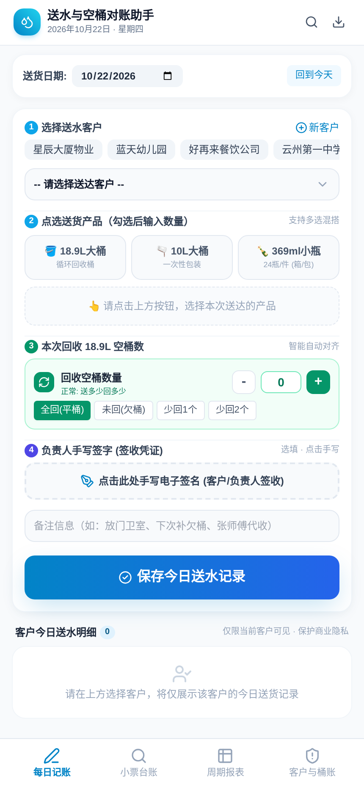
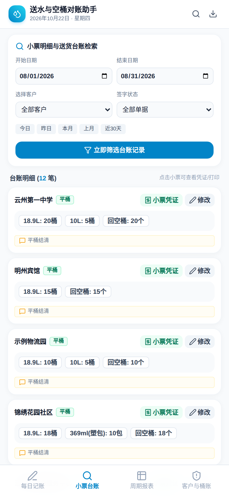
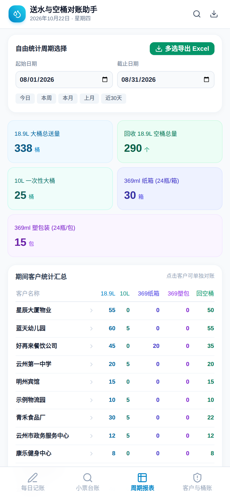
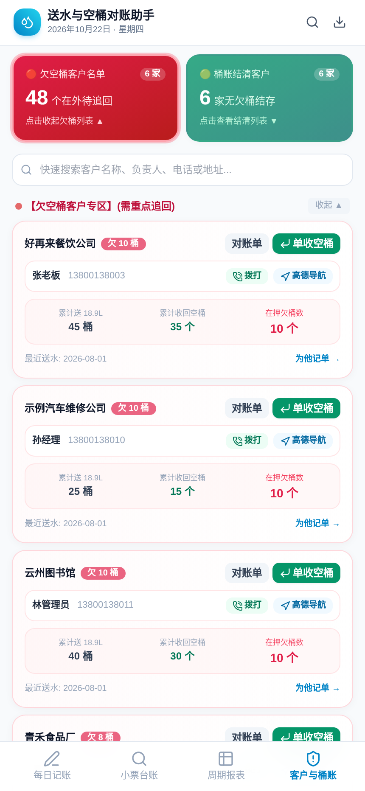

# 送水及空桶统计助手 Pro

为桶装水配送店（水店）设计的送水与空桶押金对账工具。**单文件 Web 应用**：一个 `index.html` 就是全部程序——没有服务器、没有数据库、不用注册登录，数据保存在浏览器本地，用手机浏览器打开就能干活。

解决的是水店每天最实际的四件事：**送了多少、回了多少空桶、谁还欠着桶、月底怎么对账**。

## 界面预览

> 截图中的客户与数据均为虚构示例（云州市示例数据），软件首次打开时自动载入，方便体验全部功能。

| 每日记账 | 小票台账 |
| :---: | :---: |
|  |  |
| 选客户 → 点选产品数量 → 自动对齐回收空桶 → 手写签收，一单走完 | 每笔送达生成小票；按日期、客户、签字状态检索台账，点小票看凭证 / 打印 |

| 周期报表 | 客户与桶账 |
| :---: | :---: |
|  |  |
| 任意起止日期统计各产品送量与回空桶总量，客户汇总表可点开单独对账 | 欠空桶客户红色看板重点追回；每个客户的在押 / 欠桶数一清二楚 |

## 功能模块

### 每日记账
- 先选客户（顶部有常用客户快捷条），客户当前在押 / 欠回的 18.9L 空桶数即时显示；
- 产品多选混搭：18.9L 循环大桶、10L 一次性大桶、369ml 小瓶水（纸箱 / 塑包，24 瓶 / 件）；
- 回收空桶数**智能自动对齐**（送多少回多少），也可一键标记未回（欠桶）、少回 1 个 / 2 个；
- 负责人**手写电子签名**作为签收凭证（选填），另有备注栏；
- 保存后生成当日送水明细，仅当前客户可见。

### 小票台账
- 每笔记录都是一张小票：客户、品类数量、回空桶、签字状态一目了然；
- 按开始 / 结束日期、客户、签字状态组合筛选（另有今日、昨日、本月、上月、近 30 天快捷范围）；
- 点小票查看签收凭证图，可打印；单据可修改，历史单据默认锁定防误删。

### 周期报表
- 自由选择统计周期，一屏看全：18.9L 总送量、回收空桶总量、10L、369ml 纸箱 / 塑包；
- 期间客户统计汇总表（每客户送量 / 回桶分列），点击客户单独对账；
- 支持多选导出 Excel。

### 客户与桶账
- 双看板：**欠空桶客户名单**（家数 + 在外待追回总数，红色重点区）与**桶账结清客户**（绿色区）；
- 每个客户一张桶账卡：累计送桶、累计收回、在押欠桶数、最近送水日期；
- 客户资料维护（联系人、电话、地址），卡片上一键拨打电话、一键导航；
- 可从客户卡直接「为他记单」，或单独收空桶生成对账单。

### 数据备份与恢复
- 全部数据保存在浏览器本地（localStorage），**不上传任何服务器**；
- 一键导出 JSON 备份、导入 JSON 恢复，换手机 / 换浏览器不丢账。

## 快速开始

1. 直接用浏览器打开 `index.html`；或把本仓库部署到任意静态托管（GitHub Pages、Cloudflare Pages、Netlify 等）后用手机访问；
2. 首次打开会载入虚构示例客户与示例台账，先逛一圈熟悉功能；
3. 在「客户与桶账」里把客户换成自己的（或先导出一份空白结构再导入），即可正式记账；
4. 养成习惯：每周在备份区导出一次 JSON 存好。

## 技术说明

- 纯前端单文件（约 150 KB）：HTML + 原生 JavaScript，无构建步骤，改完保存即生效；
- 样式：Tailwind CSS（CDN）；图标：Lucide；Excel 导出：SheetJS；小票凭证图：html2canvas；
- 当前版本：v7.0（持续迭代维护中）。

## License

MIT
